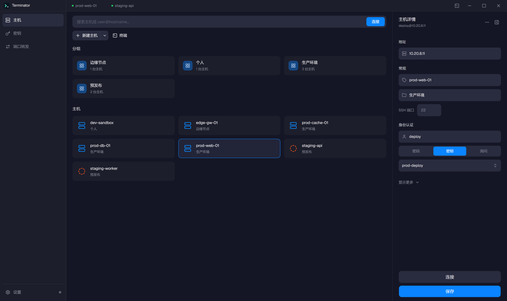
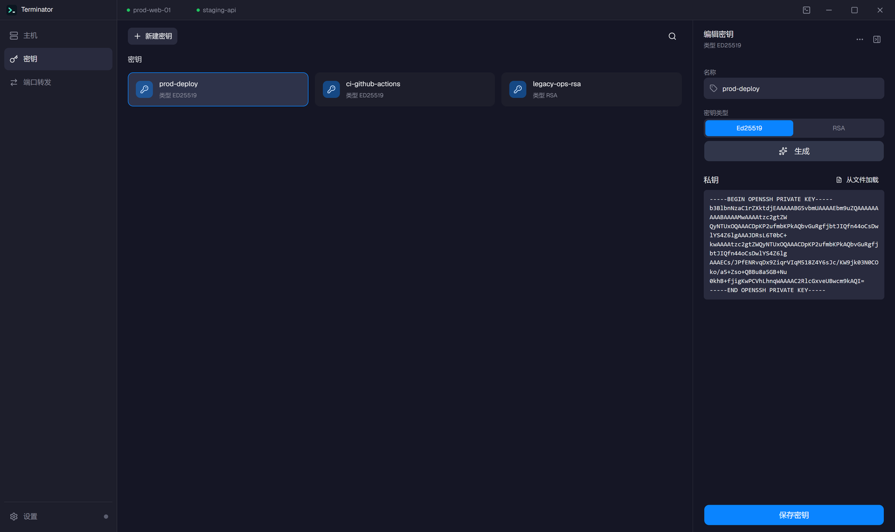
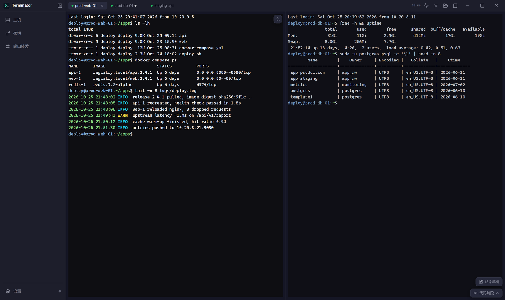
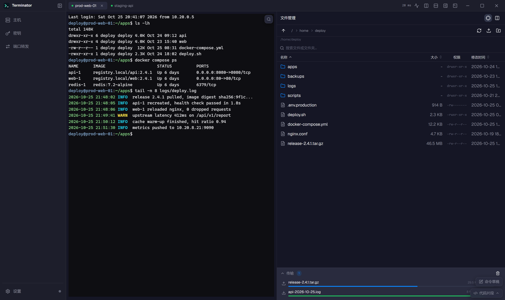
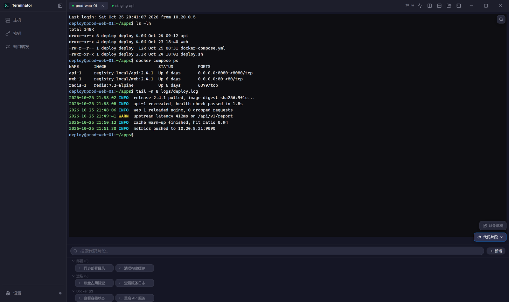
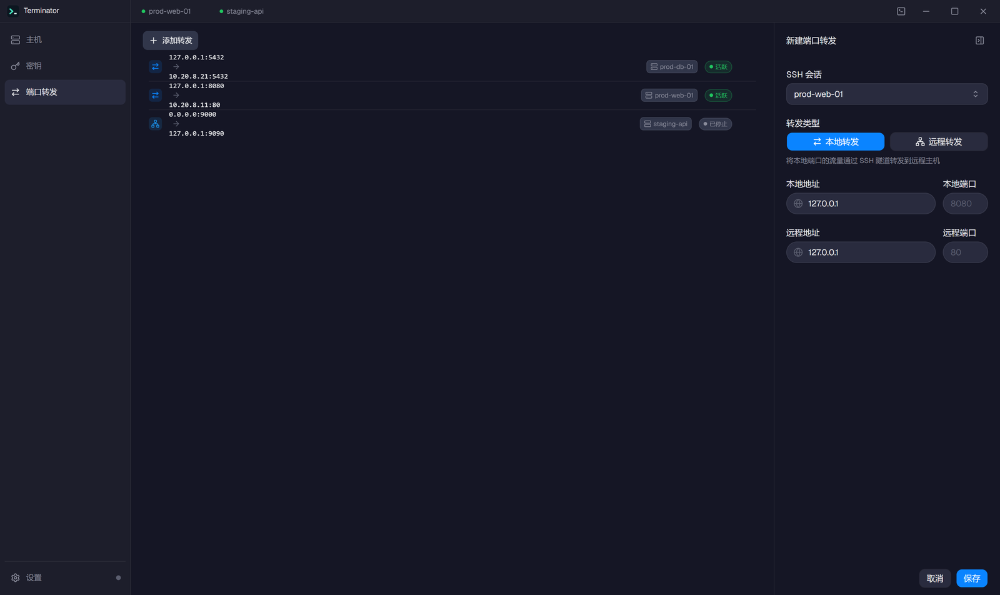
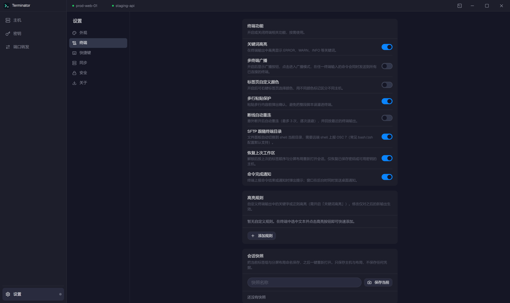

<h1 align="center">

Terminator


</h1>

<h3 align="center">

开源 SSH 客户端 · 端到端加密 · 可视化文件管理 · 多设备同步

</h3>

<p align="center">
  <a href="https://github.com/YCJE/Terminator/releases"></a>
  
  
  
</p>

---

## 概述

Terminator 是一款跨平台 SSH 客户端，专注于**安全、隐私和本地控制**。所有敏感数据（主机配置、SSH 密钥、凭据）在本地使用 Argon2id + AES-256-GCM 加密，即使使用云同步，服务器也永远无法解密你的数据。

## 界面预览

### 主机管理



- 卡片网格按分组聚合主机，搜索框同时匹配名称、地址、用户名与分组名
- 单击卡片从右侧滑出详情面板，地址、SSH 端口与认证方式可直接修改
- 认证支持密码 / 密钥 / 每次询问三种模式，密码框可切换明文查看
- 高级配置收纳在面板内：跳板机、HTTP / SOCKS5 代理、Agent 转发、登录后自动执行命令
- 支持从 `~/.ssh/config` 批量导入，也可导出 / 导入 JSON 主机清单

### 密钥管理



- 密钥加密保存在本地保险库，卡片展示名称与类型（Ed25519 / RSA）
- 内置 Ed25519 与 RSA 密钥对生成，也可从文件导入现有私钥
- 右侧面板直接编辑名称、类型与私钥内容，保存后立即用于主机连接
- 密钥与主机解耦，替换密钥后所有引用它的主机同时生效

### 终端工作区



- 多标签管理：每个标签是独立 SSH 会话，可拖动排序；标签过多时横向滚动，并把激活标签自动滚入视口
- 分屏：<kbd>Ctrl+Shift+D</kbd> 左右分屏、<kbd>Ctrl+Shift+E</kbd> 上下分屏，拖动中间分隔条调整比例（每侧最小 18%）
- 终端内搜索（<kbd>Ctrl+F</kbd>）、关键词高亮、划词高亮与输出中的链接直达浏览
- 标签颜色标记连接状态，标题栏显示往返时延；资源面板查看 1/5/15 分钟负载、内存、磁盘与运行时长
- 命令草稿栏（<kbd>Ctrl+Shift+U</kbd>）先编辑多行命令再发送，可只发当前终端或全部已连接终端

### 可视化文件管理（SFTP）



- 文件面板可在单栏列表与「目录树 + 文件列表」双面板之间切换，面板与目录树宽度都可拖动
- 文件列表展示名称、大小、权限与修改时间，上传 / 下载带实时进度与传输队列
- 大文件断点续传、远程文件直接编辑，支持新建目录、重命名、改权限与删除
- 跟随终端当前目录（OSC 7）；文件或目录可拖到终端插入路径，本地文件拖进面板即上传
- 支持当前目录即时过滤与全系统递归搜索两种模式

### 代码片段



- 片段按分组管理，支持搜索、悬停编辑 / 删除与右键菜单
- 点击片段直接在当前终端执行；右键可选择「在所有已连接终端执行」
- 片段内可使用 `{{host}}`、`{{port}}`、`{{user}}`、`{{name}}` 变量，执行时按目标会话自动展开

### 端口转发



- 本地转发与远程转发统一列表，显示监听地址、目标地址、来源会话与运行状态
- 新增面板选择 SSH 会话与端口，保存后立即生效；已停止条目可一键清理
- 移除转发或关闭会话时隧道连接随之回收，长期运行不泄漏句柄

### 设置



- 六个分类：外观、终端、快捷键、同步、安全、关于
- 外观：深色 / 浅色主题、7 种强调色、三套皮肤、三档界面密度与终端配色联动
- 终端：关键词高亮、多终端广播、标签颜色、多行粘贴保护、断线重连、SFTP 跟随目录、工作区恢复与完成通知
- 自定义高亮规则（关键字或正则）与命名会话快照均可在设置页维护

## 核心功能

### 终端

- 基于 xterm.js 6 的完整终端模拟器，支持 256 色 + Unicode 11
- 多标签页管理，每个标签独立 SSH 会话，支持拖拽排序
- Trust-On-First-Use (TOFU) 主机密钥验证，防止中间人攻击
- 终端主题跟随应用主题（深色 Abyss / 浅色 Frost）实时切换
- 终端配色与 UI 强调色联动：切换强调色后终端 ANSI 蓝色/青色/光标色同步变化
- 完整 ANSI 16 色调色板 + 256 色扩展，正确显示 `ls`/`vim`/`htop` 彩色输出
- 流控背压机制（Promise 链 + writeQueue），大输出（如 `cat` 大文件）不丢数据、不卡顿
- 滚动锚定：大输出期间用户向上滚动时自动锁定位置，不被新数据冲走
- 终端失焦自动变暗，聚焦时恢复，多面板场景一眼分辨活动终端
- 标签页状态指示灯（绿色已连接 / 黄色连接中 / 红色已断开）
- 标签页崩溃后自动恢复（SerializeAddon 会话序列化）
- **终端搜索**：Ctrl+F 呼出搜索面板，支持上一个/下一个跳转，Esc 关闭
- **关键词高亮**：实时高亮终端输出中的 ERROR/WARN/INFO/SUCCESS 等关键词，可在设置中开关
- **自定义高亮规则**：设置页可添加关键字或正则规则并选择 6 种颜色；终端里选中文本后点「高亮」，一键把所选内容加为规则
- **命令草稿栏**：Ctrl+Shift+U 展开底部草稿栏，先本地编辑多行命令再发送，可选「当前终端」或「全部已连接终端」；Ctrl+↑/↓ 回溯历史，历史按主机分别保存
- **工作区恢复**：退出前记住标签顺序、当前标签与分屏方向，下次解锁后按已保存凭据自动重建会话（跳过需要手动输入密码的主机），可在设置中开关
- **拖拽上传**：把本地文件拖进终端即上传到 shell 当前目录（OSC 7 已上报时；否则为主目录），完成后自动在命令行插入远端路径
- **多终端广播**：开启广播模式后，在一个终端输入的命令会同步发送到所有已连接终端，适合批量运维
- **分屏**：Ctrl+Shift+D 左右分屏、Ctrl+Shift+E 上下分屏，两个窗格是各自独立的 SSH 会话，点击即切换焦点
- **可拖拽分屏分隔条**：拖动分隔条调整两侧比例（每侧最小 18%），悬停与拖动时高亮，切换分屏自动回到 1:1
- **标签栏交互**：标签过多时可横向滚动，两端渐隐提示剩余标签并自动把激活标签滚入视口；拖动排序显示左右插入标记，中键快速关闭
- **命令面板**：Ctrl+Shift+P 模糊搜索主机、代码片段与常用操作（切换视图、分屏、文件面板、广播、锁库等）
- **多行粘贴保护**：粘贴多行内容前弹出确认，避免把整段脚本误灌进生产终端，可在设置中开关
- **断线自动重连**：意外断开后按 2s / 5s / 10s 退避重连（最多 3 次），并回放最近的终端输出；也可手动点击「重新连接」
- **连接延迟与资源面板**：标题栏实时显示到服务器的往返时延；点击资源图标查看 1/5/15 分钟负载、CPU 核数、内存、交换分区、根分区占用与运行时长，并附带内存与负载的迷你趋势图
- **本地终端**：一键打开本机 shell（Windows 默认 PowerShell / cmd，Unix 使用 `$SHELL`），与 SSH 标签共用搜索、高亮、分屏等终端能力
- **智能标签与完成通知**：后台标签有新输出时闪动提示，shell 集成上报命令结束时显示完成标记；终端通知（OSC 9 / 777）与命令结束（OSC 133）可弹出应用内提示，窗口在后台时同时发送桌面通知，可在设置中开关
- **终端内链接与划词搜索**：输出中的 URL 可点击并在系统浏览器打开；选中文本后可一键用 Bing 搜索或在 GitHub 搜索
- **可配置快捷键**：命令面板、终端搜索、左右/上下分屏、命令草稿栏均可在设置页录制新的组合键，支持冲突检测与恢复默认

### SSH 连接管理

- SSH 连接复用（Multiplexer）：同一主机多会话共享底层 TCP 连接，减少握手开销
- Jump Host 多级跳板机：支持链式跳转（A → B → C），连接池键包含完整链路，不同链路不会错误复用连接
- 端口转发：支持本地转发（Local Forward）和远程转发（Remote Forward），可视化 UI 管理；转发隧道连接在移除转发或关闭会话时统一回收，长期运行不泄漏句柄
- 连接池健康检查，自动剔除死连接，refCount 引用计数防止误关 in-use 连接；在途连接退役后按引用递减、归零才关闭，避免连接被覆盖时泄漏
- 保活探测去重：同一连接仅保留一个在途探测，其余复用其结果，避免并发保活导致 goroutine 无界增长
- **SSH Agent 转发**：支持 per-host 配置 Agent Forwarding，允许远程服务器通过本地 SSH Agent 认证
- **HTTP/SOCKS5 代理**：支持 per-host 配置 HTTP CONNECT 或 SOCKS5 代理连接 SSH，可设置代理认证
- **known_hosts 管理**：设置页可查看、清理已固定的主机密钥；文件原子写入，写入失败即拒绝连接（fail-closed）
- **连接后自动执行**：每台主机可配置登录后自动运行的命令（如 `tmux attach`、`cd` 到项目目录），连接成功即发送

### 主机与密钥管理

- Termius 风格侧滑面板：新增/编辑主机和密钥时从右侧滑出面板，支持拖拽调整宽度
- 主机分组：按分组管理主机，支持折叠/展开，搜索可匹配分组名
- 操作系统图标：主机列表根据 OS 类型显示不同图标（Linux/Windows/macOS）
- 交互式密码输入：可选择不保存密码，每次连接时弹出密码输入框
- SSH 密钥管理：密钥加密存储，支持密钥认证连接
- 内置密钥生成：支持 Ed25519 和 RSA 密钥对生成，可从文件导入
- **导入/导出主机配置**：支持 JSON 格式批量导出和导入主机列表（不含密码等敏感字段）
- **从 ~/.ssh/config 导入**：一键解析本机 SSH 配置中的 Host 别名、HostName、User、Port 与 ProxyJump，确认后批量写入主机列表
- **标签页自定义颜色**：右键标签页选择 8 种预设颜色，左侧色条指示，可在设置中开关

### 可视化文件管理

- FinalShell 风格侧边面板，终端右侧可折叠展开
- 双面板布局：左侧目录树导航 + 右侧文件列表，可拖拽调整宽度
- 虚拟列表渲染，万级文件目录流畅滚动
- 复用 SSH 连接的 SFTP 子通道，无需额外认证
- 面包屑导航 + 文件列表（名称/大小/权限/修改时间）
- 上传/下载（拖拽 + 按钮选择），32KB 分块传输 + 实时进度条
- **大文件断点续传**：传输中断后从断点继续；临时文件按传输总量区分，避免不同文件拼接损坏数据
- 文件操作：新建文件夹、删除、重命名、修改权限、文本预览（<1MB）
- **文件搜索**：支持当前目录即时过滤和全系统递归搜索两种模式，一键切换
- **滚动位置记忆**：进入子目录后返回上级时，自动恢复到之前的浏览位置
- **远程文件直接编辑**：预览对话框支持编辑模式，保存后直接写回远程服务器
- **跟随终端目录**：shell 通过 OSC 7 上报当前目录后，文件面板自动切换到对应路径，可在面板头部或设置中开关
- **路径拖拽与插入**：文件/目录行可直接拖到终端命令行插入带引号的远端路径，也可右键选择「插入路径到终端」
- **SFTP 面板拖拽上传**：把本地文件直接拖到文件面板即上传到当前目录（由原生窗口拖放事件转发，WebView2 下同样可用）

### 代码片段

- 侧边面板管理常用命令片段，支持搜索和分组
- 点击片段直接在当前终端执行，广播模式下同步到所有终端
- **片段变量**：命令中可使用 `{{host}}`、`{{port}}`、`{{user}}`、`{{name}}`，执行时按目标会话自动展开
- **多主机执行**：右键片段选择「在所有已连接终端执行」，每条命令按各自会话展开变量后发送
- 每个片段标签 hover 显示编辑/删除按钮，也支持右键菜单
- 新增/编辑弹窗支持分组自动补全，复用已有分组名

### 端到端加密同步

两种同步方式，均使用端到端加密，可自由切换：

| 方式 | 说明 | 适用场景 |
|---|---|---|
| **自建服务器** | HTTP API 增量同步，3 秒轮询，支持用户注册/登录 | 需要实时多设备同步 |
| **WebDAV** | 全量打包加密文件上传，60 秒间隔，ETag 乐观锁防冲突 | 坚果云/Nextcloud/群晖 NAS |

加密架构：

```
用户主密码
    ├── Argon2id + KeySalt → KEK → 加密 MasterKey
    └── Argon2id + AuthSalt → LoginKey → 服务器认证
                                           (不传主密码)
```

同步一致性与冲突处理：

- **冲突检测**：多端同时修改同一条目时记录冲突，侧边栏徽标 + 全局提示条告知
- **解决面板**：逐条选择保留本地或远端，无需手工比对
- **定长时间戳**：时间戳统一为定长格式，修复同秒变更漏同步与无变更时的冗余上传
- **替换保护**：整体替换数据（如备份导入、数据擦除）期间暂停后台同步，避免旧数据回灌
- **覆盖保护**：WebDAV 上传前校验 ETag / Last-Modified 条件，无法获得并发保护时拒绝覆盖，避免多端并发静默互相覆盖
- **窗口无缝隙**：本地时间下界叠加一个轮询间隔，修复服务器时钟领先时本地变更被永久漏同步

### 备份与恢复

- **加密备份导出**：将主机、密钥、代码片段与配置打包为加密备份文件，导出前自动断开会话并暂停同步
- **备份导入**：选择备份文件并校验密码后恢复，导入失败不会破坏现有数据

### 其他

- **本地优先**：不必连接任何服务器，纯本地使用完全没问题
- **GitHub 更新检查**：设置页一键检查 GitHub Releases 新版本
- **自动更新**：内置版本检查和更新器
- **强调色预设**：7 种强调色（默认/天蓝/翡翠/紫罗兰/琥珀/玫瑰/青色），深浅模式独立配色
- **界面密度调节**：紧凑/标准/宽松三档密度，标题栏/侧边栏/间距全面调整
- **终端配色联动**：可开关，开启后终端 ANSI 配色跟随 UI 强调色变化
- **功能开关统一管理**：关键词高亮、多终端广播、标签页颜色等功能均可在设置页终端区开关
- **会话快照**：在设置页把当前标签组与分屏布局命名保存，可一键打开、用当前布局覆盖或删除；只保存主机与布局，不落盘凭据
- **快捷键速查**：设置页「快捷键」分类集中展示并支持录制终端与标签页快捷键（命令面板、搜索、分屏、草稿栏可自定义，复制粘贴等为固定项）
- **会话日志记录**：SSH 输出实时写入日志文件，设置页的「会话日志」页签可浏览文件、预览内容并跨文件检索关键字
- **多语言**：中文/英文，首次启动默认中文
- **深色/浅色主题**：Abyss 深色 / Frost 浅色，随时切换
- **RAF 批量合并**：高频事件通过 requestAnimationFrame 合并，减少不必要的重渲染
- **错误降级**：错误分类 + 防抖窗口，避免短时间大量错误弹窗淹没用户
- **ConfigProxy 默认值擦除**：配置文件只保存用户实际修改项，保持精简
- **皮肤体系**：默认 / HUD / 编辑式三套皮肤，皮肤覆盖主题明暗（HUD 恒深色、编辑式恒浅色）
- **界面动效**：过渡统一为 160–220ms 的时长与两档缓动，菜单/弹窗/悬浮控件使用三档阴影令牌，尊重系统「减少动效」设置
- **更新包完整性校验**：下载更新包后校验 SHA256，校验不通过拒绝安装
- **幂等请求自动重试**：网络抖动时自动重试幂等接口，指数退避上限 3 秒

## 安全加固

- **端到端加密**：主密码永不离开本机；Argon2id 分别派生 KEK（加密 MasterKey）与 LoginKey（服务器认证），敏感数据一律 AES-256-GCM 加密
- **TOFU 主机密钥校验**：首次连接记录指纹，指纹变更时告警；known_hosts 原子写入，写入失败即拒绝连接
- **登录防爆破**：登录失败指数退避，主密码创建需二次确认
- **保险库状态判定**：空密钥归一化为 nil，修复解锁状态误判
- **更新通道校验**：更新页跳转仅允许 github.com（含子域）；下载安装包前校验文件名，防止路径穿越与钓鱼跳转
- **更新包校验**：更新包 SHA256 完整性校验，防止更新被篡改
- **备份文件加密**：备份全程加密，导入必须校验密码；导出写盘后 fsync，失败清理临时文件
- **同步数据保护**：数据整体替换期间暂停后台同步，避免旧数据回灌；WebDAV 无法获得并发保护时拒绝覆盖远端
- **设置防覆盖**：设置文件反序列化失败即拒绝保存，不再用空配置覆盖用户设置
- **本地端口转发**：LocalHost 为空时默认绑定 127.0.0.1，避免端口暴露到局域网
- **SFTP 安全**：ReadFile 拒绝非普通文件；断点续传按传输总量区分临时文件，避免拼接损坏数据
- **持续代码审查**：多轮模块级审计，修复并发竞态、空指针、数组越界、异常处理缺失、连接/goroutine 泄漏等问题

## 云端服务器

自建服务器同步方案的服务端代码在 [terminator-server](https://github.com/YCJE/Terminator)，Docker 一行部署：

```bash
docker run --name terminator \
  -v terminator-data:/app/data \
  -p 8080:8080 -d deeplerg/terminator
```

WebDAV 同步无需自建服务器，填入网盘地址即可使用。

## 技术架构

```
terminator/
├── backend/                          # Go 后端
│   ├── cmd/terminator-desktop/       # 应用入口 + Wails 绑定
│   │   ├── main.go                   # 服务注册和依赖注入
│   │   ├── app.go                    # 前端可调用方法
│   │   └── emitters/                 # Wails 事件发射器
│   │       ├── ssh.go                #   SSH 终端数据/关闭事件
│   │       ├── sftp.go              #   SFTP 传输进度/完成事件
│   │       ├── sync.go              #   同步状态事件
│   │       └── updater.go           #   更新器事件
│   └── internal/
│       ├── services/
│       │   ├── ssh/                  # SSH 连接管理 + PTY
│       │   ├── sftp/                 # SFTP 文件管理
│       │   ├── auth/                 # 用户认证 + 保险库
│       │   ├── backup/               # 加密备份导出/导入
│       │   ├── sync/                 # 同步引擎
│       │   │   ├── sync.go           #   服务器同步
│       │   │   ├── webdav.go         #   WebDAV 同步
│       │   │   ├── conflict.go       #   冲突检测与解决
│       │   │   └── loop.go           #   自动同步循环
│       │   ├── blob/                 # 加密数据存储
│       │   ├── settings/             # 应用配置
│       │   └── updater/              # 自动更新
│       ├── crypto/                   # Argon2id + AES-256-GCM
│       ├── vault/                    # 内存密钥管理
│       ├── webdav/                   # WebDAV HTTP 客户端
│       ├── dbgen/                    # sqlc 生成的 DB 查询
│       ├── migration/                # SQLite 迁移
│       ├── timeutil/                 # 定长时间戳格式化
│       └── apperror/                 # 错误码体系
│
├── frontend/                         # React 前端
│   └── src/
│       ├── components/
│       │   ├── terminal/             # xterm.js 终端组件
│       │   ├── sftp/                 # 文件管理面板
│       │   ├── layout/               # 布局框架
│       │   ├── views/                # 页面视图
│       │   └── ui/                   # shadcn 组件
│       ├── store/                    # Zustand 状态管理
│       ├── lib/                      # 工具函数
│       └── i18n/                     # 多语言
│
└── build/                            # 构建资源 + NSIS 安装包
```

**技术栈**：Go 1.25 + Wails v3 + React 19 + TypeScript + Tailwind CSS 4 + shadcn/ui + Zustand + xterm.js 6 + SQLite

## 开发

### 环境要求

1. [Go](https://go.dev/dl/) 1.25+
2. [Node.js](https://nodejs.org/) v24+
3. 推荐安装 [pnpm](https://pnpm.io/installation#using-corepack)
4. [Wails3 CLI](https://v3.wails.io/getting-started/installation/)

### 开发模式

```bash
wails3 dev
```

远程调试（[delve](https://github.com/go-delve/delve)）：

```bash
dlv debug --headless --listen=:2345 ./backend/cmd/terminator-desktop -- dev
```

### 打包

```bash
wails3 task package
```

## 开发路线

- [x] 端到端加密（Argon2id + AES-256-GCM）
- [x] 多设备同步（自建服务器 + WebDAV）
- [x] SSH 密钥管理
- [x] 深色/浅色主题
- [x] SFTP 可视化文件管理
- [x] 终端 256 色支持
- [x] 多语言（中文/英文）
- [x] 主机分组
- [x] 交互式密码输入
- [x] SSH 连接复用 + Jump Host 跳板机
- [x] 端口转发（本地/远程）+ 可视化管理界面
- [x] 终端流控背压 + 滚动锚定 + 虚拟列表
- [x] 强调色预设 + 终端配色联动
- [x] 界面密度调节（紧凑/标准/宽松）
- [x] 侧滑面板 UI（Termius 风格，可拖拽调整宽度）
- [x] 标签页恢复（SerializeAddon）
- [x] RAF 批量合并 + 错误去抖
- [x] ConfigProxy 默认值擦除
- [x] 文件搜索（当前目录过滤 + 全系统递归搜索）
- [x] 滚动位置记忆（目录导航后恢复浏览位置）
- [x] 代码片段管理（分组、搜索、一键执行、编辑删除）
- [x] 多终端广播模式（批量运维）
- [x] 终端关键词高亮（ERROR/WARN/INFO/SUCCESS）
- [x] SSH Agent 转发（per-host 配置）
- [x] HTTP/SOCKS5 代理（per-host 配置）
- [x] 标签页自定义颜色（8 色预设）
- [x] 主机配置导入/导出（JSON 格式）
- [x] 远程文件直接编辑（预览 → 编辑 → 保存）
- [x] 终端搜索（Ctrl+F）
- [x] 会话日志记录 + 设置页查看
- [x] 功能开关统一管理（设置页终端区）
- [x] 快捷键速查（设置页「快捷键」分类）
- [x] 多级跳板机链式连接
- [x] 大文件断点续传
- [x] 加密备份导出与导入
- [x] 同步冲突检测与解决面板
- [x] known_hosts 管理与密钥变更引导
- [x] 更新包 SHA256 完整性校验
- [x] 幂等请求自动重试（指数退避）
- [x] 皮肤体系（默认 / HUD / 编辑式）
- [x] 质量门禁（vet / gofmt / test / tsc）+ 语言包键一致性校验
- [x] 分屏（左右 / 上下，独立会话）
- [x] 命令面板（Ctrl+Shift+P）
- [x] 主机连接后自动执行命令
- [x] ~/.ssh/config 导入
- [x] 多行粘贴保护
- [x] 断线自动重连与会话回放
- [x] 连接延迟显示 + 服务器资源面板
- [x] 片段变量与多主机执行
- [x] SFTP 跟随终端目录（OSC 7）
- [x] 会话日志浏览与全库检索
- [x] 工作区恢复（标签顺序 / 分屏布局 / 活跃标签）
- [x] 命令草稿栏 + 按主机命令历史
- [x] 自定义高亮规则 + 划词高亮
- [x] 拖拽上传（终端 → SFTP 当前目录）
- [x] 本地终端（内置 PTY，无需 SSH）
- [x] 智能标签与完成通知（OSC 9 / 777 / 133，桌面通知）
- [x] 监控增强（负载 / CPU 核数 / swap + 迷你趋势图）
- [x] SFTP 路径拖拽与「插入路径到终端」
- [x] 会话快照（命名标签组，打开 / 覆盖 / 删除）
- [x] 可配置快捷键（录制、冲突检测、恢复默认）
- [x] 终端内链接与划词搜索（Bing / GitHub）
- [x] Termius 风格界面重构（卡片 / 列表 / 详情面板统一）
- [x] 可拖拽分屏分隔条 + 标签栏溢出滚动与拖拽反馈
- [x] 全局动效节奏统一（160–220ms + 三档浮层阴影）
- [ ] Zmodem / trzsz 文件传输
- [ ] 多配置文件（团队）
- [ ] Android 客户端
- [ ] CLI 客户端

缺少什么功能？欢迎提 [Issue](https://github.com/YCJE/Terminator/issues/new)。

## 致谢

本项目基于 [Terminator](https://github.com/terminator-ssh/terminator-desktop) 开源项目，在其基础上进行了功能扩展和改进。

灵感来源：[Termius](https://termius.com)、[Netcatty](https://netcatty.com)、[Tabby](https://tabby.sh)、[Warp](https://www.warp.dev)

技术框架：[Wails](https://v3.wails.io)

UI 组件：[shadcn](https://ui.shadcn.com)

---

[English](./README_EN.md)
