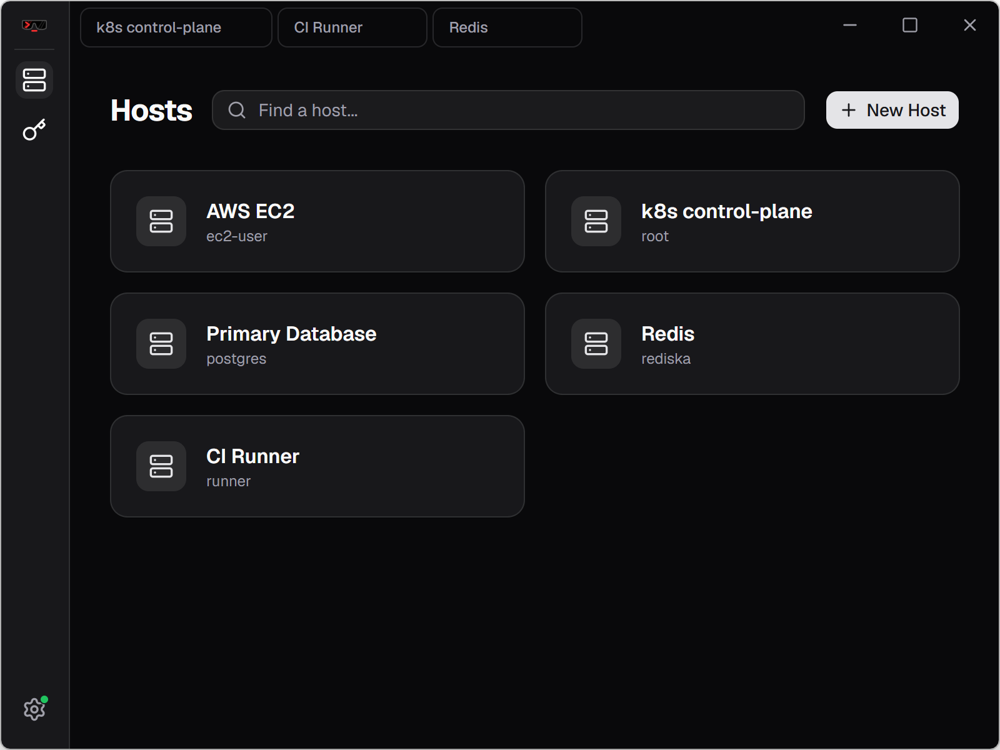
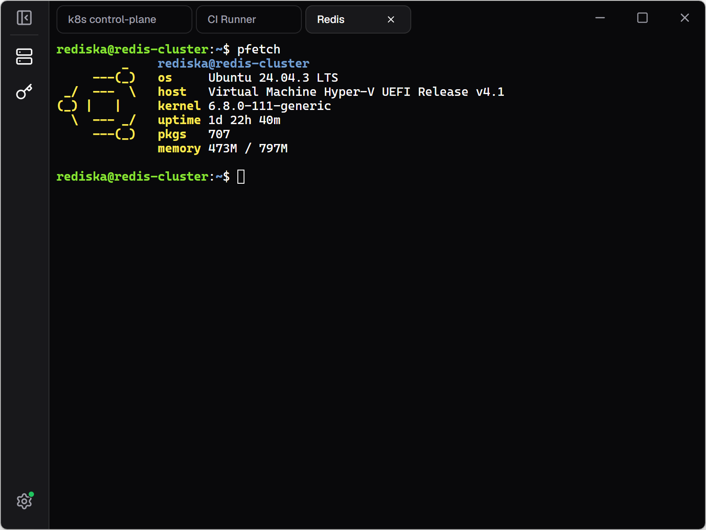

<h1 align="center">

Terminator

   

</h1>

<h3 align="center">

Self-hostable SSH client with sync

</h3>

Terminator is a cross-platform SSH client built with [Wails v3](https://v3.wails.io/) and Go. Supports self-hosted servers for sync.

## Screenshots

### Hosts


- Card grid groups hosts by group; the search box matches name, address, username and group name
- Clicking a card opens a slide-in details panel for address, SSH port and authentication
- Authentication supports password / key / ask-each-time, with a plain-text toggle for passwords
- Advanced options live in the same panel: jump host, HTTP / SOCKS5 proxy, agent forwarding, run on connect
- Import hosts from `~/.ssh/config`, or export / import a JSON host list

### Keys


- Keys are stored encrypted in the local vault; cards show the name and type (Ed25519 / RSA)
- Generate Ed25519 or RSA key pairs in-app, or import an existing private key from a file
- Edit the name, type and private key in the side panel; changes apply to host connections immediately
- Keys are decoupled from hosts, so swapping a key updates every host that references it

### Terminal workspace


- Multi-tab management: each tab is its own SSH session and can be reordered by dragging; overflowing tabs scroll horizontally and reveal the active tab automatically
- Split panes: <kbd>Ctrl+Shift+D</kbd> for side-by-side, <kbd>Ctrl+Shift+E</kbd> for stacked; drag the divider to resize (18% minimum per side)
- In-terminal search (<kbd>Ctrl+F</kbd>), keyword highlighting, highlight selection, and clickable links in the output
- Tab colors show connection state, the title bar shows round-trip latency, and the resource panel reports 1/5/15-minute load, memory, disk usage and uptime
- Compose bar (<kbd>Ctrl+Shift+U</kbd>) lets you edit multi-line commands before sending to the current terminal or all connected terminals

### Visual file management (SFTP)


- The file panel switches between a single list and a dual pane (directory tree + file list); both the panel and the tree width are draggable
- The list shows name, size, permissions and modification time; uploads and downloads report live progress in a transfer queue
- Resumable large transfers, direct remote file editing, mkdir, rename, chmod and delete
- Follows the shell's current directory (OSC 7); drag a row onto the terminal to insert its path, or drop local files onto the panel to upload
- Switch between instant current-directory filtering and full recursive search

### Snippets


- Snippets are grouped and searchable, with hover edit / delete actions and a context menu
- Click a snippet to run it in the current terminal; the context menu can run it on every connected terminal
- Commands may use `{{host}}`, `{{port}}`, `{{user}}` and `{{name}}` variables, expanded per target session

### Port forwarding


- Local and remote forwards share one list showing the listening address, target, source session and status
- The create panel picks an SSH session and ports; entries take effect immediately and stopped ones can be cleared
- Removing a forward or closing its session reclaims the tunnel, so long runs do not leak handles

### Settings


- Six categories: appearance, terminal, shortcuts, sync, security, about
- Appearance: dark / light theme, 7 accent colors, three skins, three density levels and terminal color linking
- Terminal: keyword highlighting, broadcast mode, tab colors, paste protection, auto reconnect, SFTP follow directory, workspace restore and completion notifications
- Custom highlight rules (keyword or regex) and named session snapshots are managed from the same page

## Features

### Terminal

- Full terminal emulator based on xterm.js 6, 256-color + Unicode 11
- Multi-tab management, each tab has independent SSH session, drag-to-reorder
- Trust-On-First-Use (TOFU) host key verification
- Terminal theme follows app theme (Abyss dark / Frost light) with real-time switching
- Terminal color linked to UI accent color — ANSI blue/cyan/cursor sync on change
- Flow control backpressure (Promise chain + writeQueue) — no data loss on large outputs
- Scroll anchoring — locks scroll position during large outputs
- Tab status indicators (green=connected / yellow=connecting / red=disconnected)
- Session recovery via SerializeAddon after crash
- **Terminal search** — Ctrl+F to search output, prev/next navigation, Esc to close
- **Keyword highlighting** — real-time highlight of ERROR/WARN/INFO/SUCCESS keywords, toggleable in settings
- **Custom highlight rules** — add keyword or regex rules with six colors in settings; select text in a terminal and click "Highlight" to add it as a rule
- **Command compose bar** — Ctrl+Shift+U opens a bottom bar to edit multi-line commands before sending to the current or all connected terminals; Ctrl+↑/↓ walks history, stored per host
- **Workspace restore** — remembers tab order, active tab and split orientation; rebuilt after unlock using saved credentials (hosts requiring a manual password are skipped), toggleable in settings
- **Drag-and-drop upload** — drop local files onto a terminal to upload them to the shell's current directory (when reported via OSC 7, otherwise the home directory) and insert the remote paths on the prompt
- **Multi-terminal broadcast** — type in one terminal, commands sync to all connected terminals for batch ops
- **Split panes** — Ctrl+Shift+D to split right, Ctrl+Shift+E to split down; each pane is its own SSH session, click to switch focus
- **Draggable split divider** — drag the divider to resize both panes (18% minimum per side); highlighted on hover and while dragging, resets to 1:1 whenever the split changes
- **Tab bar interactions** — horizontal overflow scrolling with edge fades and auto-reveal of the active tab; drag to reorder with directional insert markers; middle-click to close
- **Command palette** — Ctrl+Shift+P fuzzy-searches hosts, snippets and common actions (switch views, split, file panel, broadcast, lock vault)
- **Multi-line paste protection** — confirms before pasting multiple lines, so a whole script can't be accidentally pasted into a production shell; toggleable in settings
- **Auto reconnect** — retries at 2s / 5s / 10s (up to 3 attempts) after an unexpected disconnect and replays recent output; a manual "Reconnect" button is also available
- **Latency and resource panel** — the title bar shows round-trip time to the server; click the resource icon for 1/5/15-minute load, CPU count, memory, swap, root disk usage and uptime, plus mini trend charts for memory and load
- **Local terminal** — open a local shell in one click (PowerShell / cmd on Windows, `$SHELL` on Unix) with the same search, highlighting and split-pane features as SSH tabs
- **Smart tabs and completion notifications** — background tabs pulse when new output arrives and show a completion marker when shell integration reports a finished command; OSC 9 / 777 notifications and OSC 133 command-end markers produce in-app toasts and desktop notifications while the window is in the background (toggleable in settings)
- **Links and selection search** — URLs in the output open in the system browser; selected text can be searched on Bing or GitHub in one click
- **Configurable shortcuts** — record new key combinations for the command palette, terminal search, splits and compose bar in settings, with conflict detection and reset-to-default

### SSH Connection

- SSH connection multiplexing — multiple sessions share one TCP connection
- Multi-level Jump Host — chained hops (A → B → C); the connection pool key includes the full chain, so different chains never share a connection
- Port Forwarding — Local and Remote forward with visual UI management; tunnel connections are reclaimed when a forward is removed or the session closes, so no handle leaks over long runs
- Connection pool health check, refCount prevents closing in-use connections; retired in-flight connections are decremented by reference and only closed at zero, avoiding leaks when a pooled entry is replaced
- Keepalive probe dedup — at most one in-flight probe per connection, others reuse its result, so concurrent keepalives can't grow goroutines unbounded
- **SSH Agent Forwarding** — per-host Agent Forwarding config, allows remote server auth via local SSH Agent
- **HTTP/SOCKS5 Proxy** — per-host proxy config for SSH connections via HTTP CONNECT or SOCKS5, with proxy auth
- **known_hosts management** — view and remove pinned host keys in settings; atomic writes, and a failed write rejects the connection (fail-closed)
- **Run on connect** — per-host command executed automatically after login (e.g. `tmux attach`, `cd` into a project directory)

### Host & Key Management

- Termius-style slide panel for add/edit — draggable width adjustment
- Host grouping with collapse/expand, search by group name
- OS-specific icons (Linux/Windows/macOS)
- Interactive password input — optionally don't save passwords
- SSH key management — encrypted storage, key-based auth
- Built-in key generation — Ed25519 and RSA, import from file
- **Host import/export** — batch export and import host configs as JSON (passwords excluded)
- **Import from ~/.ssh/config** — parses Host aliases, HostName, User, Port and ProxyJump from your local SSH config and writes them in bulk after confirmation
- **Custom tab colors** — right-click tab to pick from 8 preset colors, toggleable in settings

### Visual File Management

- FinalShell-style side panel, collapsible
- Dual-panel layout: directory tree + file list, draggable width
- Virtual list rendering for 10k+ files
- SFTP over existing SSH connection
- Upload/download with 32KB chunking + real-time progress
- **Resumable transfers** — large transfers resume from the last offset; temp files are scoped by total size to avoid corrupt concatenation
- File operations: mkdir, delete, rename, chmod, text preview
- **File search** — current directory filter and full recursive search modes
- **Scroll position memory** — restores browse position after navigating back
- **Remote file editing** — preview dialog supports edit mode, save back to server
- **Follow terminal directory** — the file panel switches to the directory reported by the shell via OSC 7; toggle in the panel header or settings
- **Path drag and insert** — drag a file or folder row onto a terminal to insert its quoted remote path, or use the "Insert path into terminal" context menu item
- **Drag-and-drop upload on the panel** — drop local files onto the SFTP panel to upload them to the current directory (forwarded from native window drop events, so it also works under WebView2)

### Snippets

- Side panel for managing common command snippets, searchable and groupable
- Click a snippet to execute in the current terminal; broadcasts to all terminals in broadcast mode
- **Snippet variables** — use `{{host}}`, `{{port}}`, `{{user}}` or `{{name}}` in a command; they are expanded per target session
- **Run on all hosts** — right-click a snippet and choose "Run on all connected terminals"; each command is expanded per session
- Hover any snippet chip to reveal edit/delete buttons; right-click menu also available
- Add/edit dialog supports group autocomplete from existing groups

### End-to-End Encrypted Sync

Two sync methods, both E2E encrypted, freely switchable:

| Method | Description | Use Case |
|---|---|---|
| **Self-hosted Server** | HTTP API incremental sync, 3s polling | Real-time multi-device sync |
| **WebDAV** | Full encrypted blob upload, 60s interval | Nutstore/Nextcloud/NAS |

Sync consistency and conflict handling:

- **Conflict detection** — concurrent edits to the same entry are recorded as conflicts, surfaced via a sidebar badge and a global banner
- **Resolution panel** — pick local or remote per conflict, no manual diffing
- **Fixed-width timestamps** — prevents missed syncs within the same second and redundant uploads when nothing changed
- **Replacement guard** — background sync pauses while data is wholesale replaced (e.g. backup import or data wipe), preventing stale data from flowing back
- **Overwrite guard** — WebDAV uploads are gated on ETag / Last-Modified conditions and refuse to overwrite the remote when no concurrency protection is available, preventing silent multi-device overwrites
- **Seamless windows** — the local-time lower bound adds one polling interval, fixing local changes that would be permanently missed when the server clock runs ahead

### Backup & Restore

- **Encrypted backup export** — packs hosts, keys, snippets and settings into an encrypted backup; disconnects sessions and pauses sync first
- **Backup import** — password-verified restore that never damages existing data on failure

### Security

- **End-to-end encryption** — the master password never leaves your machine; Argon2id derives a KEK (encrypts the MasterKey) and a LoginKey (server auth); all sensitive data is AES-256-GCM encrypted
- **TOFU host key verification** — fingerprints are pinned on first connect and alerted on change; known_hosts is written atomically and a failed write rejects the connection
- **Brute-force protection** — exponential backoff on failed logins, confirmation required when creating the master password
- **Vault state check** — empty keys normalize to nil, fixing unlock-state misjudgement
- **Update channel checks** — release-page opens are restricted to github.com (and subdomains); installer file names are validated before download, blocking path traversal and phishing redirects
- **Update verification** — SHA256 integrity check on downloaded update packages
- **Encrypted backups** — backups are encrypted end to end; import always requires the password; exports are fsync'd to disk and temp files cleaned up on failure
- **Sync data protection** — background sync pauses during wholesale data replacement; WebDAV refuses to overwrite the remote without concurrency protection
- **Settings overwrite guard** — a failed settings deserialization rejects the save instead of overwriting settings with an empty config
- **Local port forwarding** — an empty LocalHost binds to 127.0.0.1 to avoid LAN exposure
- **SFTP safety** — ReadFile rejects non-regular files; resumable transfers scope temp files by total size
- **Continuous review** — multiple module-level audit rounds fixing races, nil dereferences, out-of-bounds access, missing error handling, and connection/goroutine leaks

### Other

- **Local-first** — no server required
- **Accent color presets** — 7 colors (default/sky/emerald/violet/amber/rose/cyan), independent dark/light palettes
- **UI density** — compact/standard/relaxed, adjusts title bar/sidebar/spacing
- **Terminal color link** — toggleable, terminal ANSI follows UI accent
- **Feature toggles** — keyword highlight, broadcast, tab colors all toggleable in settings
- **Session snapshots** — name and save the current tab group and split layout; open, overwrite or delete snapshots from settings. Only hosts and layout are stored, never credentials
- **Shortcut reference and recording** — the settings "Shortcuts" section records terminal and tab shortcuts (palette, search, splits and compose bar are customizable; copy/paste etc. are fixed)
- **Session logging** — SSH output written to log files in real-time; the "Session" tab in settings lets you browse files, preview content and search across logs
- **Multi-language** — Chinese/English, Chinese default on first launch
- **Dark/Light themes** — Abyss / Frost
- **Motion system** — 160–220ms transitions with two easing curves, three elevation shadows for menus/dialogs/floating controls, respects the system reduce-motion preference
- **RAF batch merge** — high-frequency events merged via requestAnimationFrame
- **Error debouncing** — classified errors + debounce window
- **ConfigProxy** — config file only stores user-modified values
- **Skins** — Default / HUD / Editorial; a skin overrides the light/dark theme (HUD is always dark, Editorial always light)
- **Update integrity** — SHA256 verified before installing an update
- **Idempotent retries** — idempotent API calls auto-retry on network blips, capped at 3s exponential backoff
- **Auto-update** — built-in version checker and updater

## Roadmap

- [x] Encryption (Argon2id + AES-256-GCM)
- [x] Multi-device sync (self-hosted + WebDAV)
- [x] SSH keys
- [x] Dark/Light theme switcher
- [x] SFTP visual file management
- [x] 256-color terminal
- [x] Multi-language (Chinese/English)
- [x] Host groups
- [x] Interactive passwords
- [x] SSH connection multiplexing + Jump Host
- [x] Port forwarding (local/remote) + visual UI
- [x] Flow control + scroll anchoring + virtual list
- [x] Accent colors + terminal color link
- [x] UI density adjustment
- [x] Slide panel UI (Termius-style, draggable)
- [x] Tab recovery (SerializeAddon)
- [x] RAF batch + error debounce
- [x] ConfigProxy default value erasure
- [x] Snippet management (groups, search, one-click execute, edit/delete)
- [x] Multi-terminal broadcast mode (batch ops)
- [x] Terminal keyword highlighting (ERROR/WARN/INFO/SUCCESS)
- [x] SSH Agent forwarding (per-host config)
- [x] HTTP/SOCKS5 proxy (per-host config)
- [x] Custom tab colors (8 presets)
- [x] Host config import/export (JSON)
- [x] Remote file editing (preview → edit → save)
- [x] Terminal search (Ctrl+F)
- [x] Session logging + settings viewer
- [x] Unified feature toggles (settings → terminal)
- [x] Shortcut reference (settings → Shortcuts section)
- [x] Multi-level chained jump hosts
- [x] Resumable large-file transfers
- [x] Encrypted backup export/import
- [x] Sync conflict detection and resolution panel
- [x] known_hosts management + key change guidance
- [x] SHA256 integrity check for updates
- [x] Idempotent request retries (exponential backoff)
- [x] Skin system (Default / HUD / Editorial)
- [x] Quality gates (vet / gofmt / test / tsc) + locale key parity check
- [x] Split panes (horizontal / vertical, independent sessions)
- [x] Command palette (Ctrl+Shift+P)
- [x] Run-on-connect commands per host
- [x] Import from ~/.ssh/config
- [x] Multi-line paste protection
- [x] Auto reconnect with session replay
- [x] Latency badge + server resource panel
- [x] Snippet variables and multi-host execution
- [x] SFTP follows terminal directory (OSC 7)
- [x] Session log browsing and cross-file search
- [x] Workspace restore (tab order / split layout / active tab)
- [x] Command compose bar with per-host history
- [x] Custom highlight rules + highlight selection
- [x] Drag-and-drop upload (terminal → SFTP current directory)
- [x] Local terminal (built-in PTY, no SSH required)
- [x] Smart tabs and completion notifications (OSC 9 / 777 / 133, desktop notifications)
- [x] Enhanced monitoring (load / CPU count / swap + mini trend charts)
- [x] SFTP path drag and "Insert path into terminal"
- [x] Session snapshots (named tab groups; open / overwrite / delete)
- [x] Configurable shortcuts (recording, conflict detection, reset)
- [x] Terminal links and selection search (Bing / GitHub)
- [x] Termius-style UI overhaul (unified cards / lists / detail panels)
- [x] Draggable split divider + tab overflow scrolling and drag feedback
- [x] Unified motion rhythm (160–220ms + three overlay shadows)
- [ ] Zmodem / trzsz file transfer
- [ ] Multiple profiles (teams)
- [ ] Android client
- [ ] CLI client

Something missing? Suggest more! [Issues](https://github.com/YCJE/Terminator/issues/new)

## Screenshots




## Development

### Prerequisites

1. [**Go**](https://go.dev/dl/) (1.25+)
2. [**Node.js**](https://nodejs.org/en/download/current) (v24+)
3. *Preferrably* [**pnpm**](https://pnpm.io/installation#using-corepack)
4. [**Wails3 CLI**](https://v3.wails.io/getting-started/installation/)

### Build

For development:
```
wails3 dev
```

Debug with [delve](https://github.com/go-delve/delve/tree/master/Documentation/installation):
```sh
dlv debug --headless --listen=:2345 ./backend/cmd/terminator-desktop -- dev
```

Package:
```
wails3 task package
```

### Acknowledgements

Inspired by: [Termius](https://termius.com)

Built on: [Wails](https://v3.wails.io)

Beautiful UI: [shadcn](https://ui.shadcn.com)

---

[中文](./README.md)
